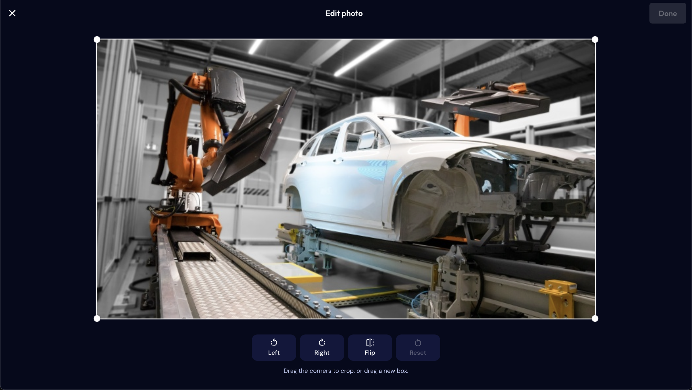
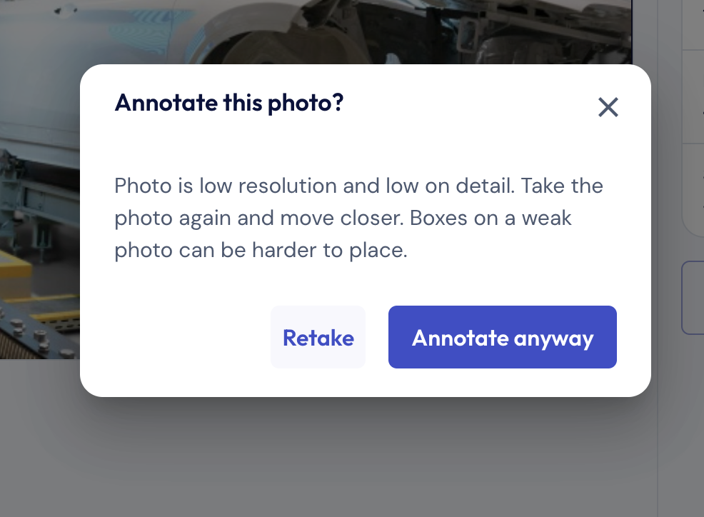
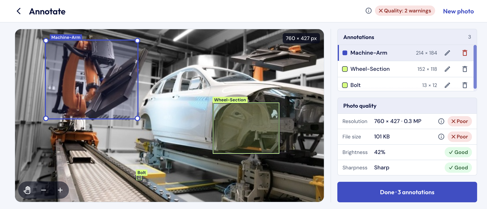
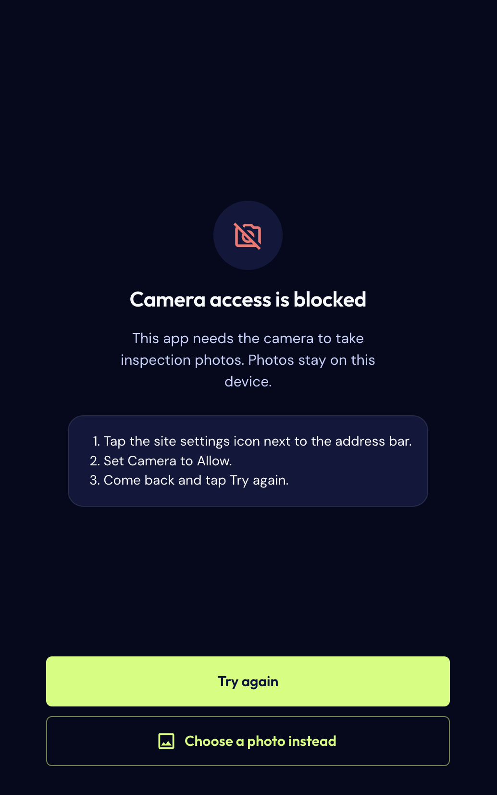

#  Loopr Annotate

A mobile-first web app for visual inspection: take a photo, check its quality, and mark problems with labelled boxes.

- **Live app:** [Open Loopr Annotate](https://painfully-legal-viper.ngrok-free.app/)
- **Flow:** Landing → Camera permission → Capture → Preview & quality → Annotate → Summary

## Demos

### Mobile

- [Watch the mobile demo](https://drive.google.com/file/d/1bcFdxtKgmOIa0k1NVfS2l8C6WmcPGFDt/view?usp=sharing)

## Screenshots

**Edit photo**: turn, flip and crop before annotating



**Quality warning**: a weak photo asks before annotating



**Annotate (desktop)**



**Camera blocked (mobile)**: clear steps to fix it, or choose a photo instead



## Run it locally

Needs Node.js 22.12+.

```bash
git clone https://github.com/vkinsane/loopr-ai-annotate-app.git
cd loopr-ai-annotate-app
npm install
npm run dev          # app
npm run lint         # oxlint
npm run test:e2e     # builds the app, then runs the Playwright tests
```

For the tests, install the browser once with `npx playwright install chromium`.

## Features

- **Capture**
  - Rear camera at the highest resolution the device gives.
  - Live resolution, brightness and sharpness chips, with a hint ("Too dark, so turn on the torch").
  - Grid, level, exposure, torch and camera list. On a computer, the ones it can't use say "not available".
  - Clear screens for a blocked, missing or busy camera, with "Try again" and "Choose a photo instead".
- **Preview & quality**
  - Resolution, file size, brightness and sharpness, each graded Good / Warning / Poor, with advice.
  - Edit (turn, flip, crop) and full-screen zoom.
- **Annotate**
  - Drag to draw a box, drag a box to move it, drag a corner to resize it.
  - Name, select and delete boxes from the list; zoom in for small details.
- **Summary:** name the photo and download it with the boxes and labels drawn on it.

## Technical notes

### Image capture
- I ask for `facingMode: 'environment'` and an **ideal** size of 4096 × 3072.
  - `ideal` never fails, so every camera opens at its best size.
  - 4:3 matches most phone sensors, so nothing is cropped to 16:9.
- I use `ImageCapture.takePhoto()` where it exists (Chrome, Android) for full sensor resolution.
- On other browsers (including iPhone) I draw the full-size video frame to a canvas and save a JPEG.
- The camera is released when the screen closes or the page is hidden.

### Quality assessment
- Checked live every 250 ms on the camera view, and once on the saved photo.
- Both use a 320 px wide grey copy, so it is fast and scores the same on any device.
- **Brightness:** how light the photo is on average, from 0 (black) to 255 (white).
- **Sharpness:** how strong the edges are. A sharp photo has clear edges and scores high; a blurry one scores low.
- The worst grade decides the result. A poor photo is never blocked: Retake becomes the main button and Annotate asks first.

#### Thresholds

| Check | Good | Warning | Poor |
|---|---|---|---|
| Resolution | ≥ 8 MP | 2–8 MP | < 2 MP |
| File size | ≥ 500 KB | 150–500 KB | < 150 KB |
| Brightness | 70–190 | 40–70 or 190–220 | < 40 or > 220 |
| Sharpness | ≥ 60 | 20–60 | < 20 |

#### How I chose them

- **Resolution**
  - **Good from 8 MP** (about 3264 × 2448): enough to zoom 2–3× into a small defect and still see it clearly. Most phone rear cameras give 12 MP or more, so they pass.
  - **Poor below 2 MP** (about Full HD, 1920 × 1080): the level of a basic laptop webcam. Small cracks or scratches are lost when you zoom in.
- **File size**
  - A detailed 8–12 MP JPEG is usually 1–5 MB. Under **500 KB** usually means a small, heavily compressed or very plain photo.
  - It's only a rough signal (JPEG compression changes it), so it only warns and never blocks.
- **Brightness** (average on a 0–255 scale)
  - A well-lit photo averages around the middle, about 100–150, so **70–190** counts as Good.
  - **Below 40** most of the photo is in deep shadow, and **above 220** most of it is close to white. In both cases detail is lost, so they're Poor.
  - The two Warning bands (40–70 and 190–220) catch "a bit dark" or "a bit bright" before it gets bad.
- **Sharpness** (edge strength on a 320 px grey copy)
  - Measured on the same small copy for the live view and the photo, so one set of numbers works on every camera.
  - A flat or blurred image scores close to 0; the sharper the edges, the higher the score. I put **20** as "clearly blurry" and **60** as "sharp enough to annotate", based on test images.

### Annotation
- Boxes are stored in **photo pixels** and drawn as **percentages** of the photo, so they stay aligned at any screen size, rotation or zoom.
- Boxes are HTML elements, so labels are real text and corner handles stay 44 px to touch.
- One gesture, decided by where it starts: corner → resize, box → move, empty photo → draw. Tiny boxes from a tap are ignored.
- All box maths is in pure functions (`utils/geometry.js`) and a reducer (`utils/annotations.js`).

## Technical decisions

- **React + Vite + MUI, plain JavaScript.** Small setup for a one-week task. MUI gives accessible dialogs and menus.
- **Only one extra library:** `react-zoom-pan-pinch` for zoom.
- **State in `App`** (photo, quality, boxes), so going back and forth between steps keeps the work.
- **One hook per device feature:** `useCamera`, `useTorch`, `useExposure`, `useDeviceTilt`, `useCameraList`.
- **No router:** `useScreenHistory` links the steps to the browser's Back and Forward.
- **Code splitting:** Annotate, Summary, zoom and the editor load only when needed.
- **Styling:** each component has a `Name.styles.js` file; all colours come from `theme.js`.

## Trade-offs

- **iPhone photos are video frames,** because Safari has no `ImageCapture`. They are often still 12 MP, but not always.
- **Editing a photo clears its boxes** (after a warning). Moving boxes through a crop or turn was not worth the extra code.
- **Browser Back starts over** after the camera opens (after a warning). This avoids half-finished states.
- **Nothing is saved or uploaded.** Photos stay private, but a reload loses the work.

## Testing

- **208 Playwright tests** on the production build, in Chromium with a simulated camera.
- **Logic:** box maths, grade limits, name and file rules, camera error messages.
- **Flows:** camera or chosen photo → download, Back/Forward, warnings before losing work.
- **Annotation:** draw, move, resize, small boxes, zoom, rotation, touch.
- **Camera:** permission allowed/denied, no camera, camera busy, torch, exposure, level, switching camera.
- **Failures:** slow or failed screen loads, going offline, failed download.
- **Screens:** 320 px phones to 1440 px desktops and tablets, 200% zoom, 44 px tap targets.
- **Accessibility:** automatic checks on every screen. Buttons, dialogs and the box list also work with a keyboard.

## Folder structure

```
src/
├─ App.jsx         # steps, photo, quality and boxes
├─ theme.js        # colours, layout rule, shared styles
├─ screens/        # one file per step
├─ components/     # one folder per component, with its styles
├─ hooks/          # camera, torch, exposure, level, quality, history
└─ utils/          # pure logic: geometry, quality, validation, image
e2e/               # Playwright tests
```
